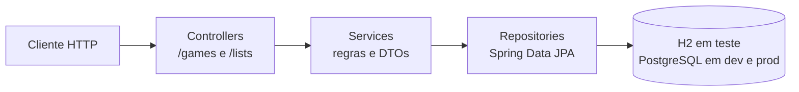
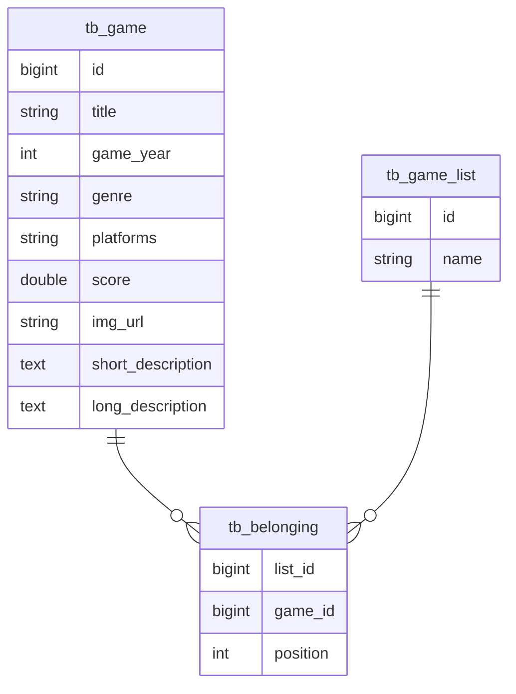

# DSList

API REST de listas de jogos feita com Java e Spring Boot. Ela devolve os jogos cadastrados,
os detalhes de cada um, as listas (por exemplo "Aventura e RPG" e "Jogos de plataforma") e
permite mudar a posição de um jogo dentro de uma lista.

## Por que eu fiz isso

Fiz este projeto acompanhando um curso da DevSuperior, para praticar o básico de um backend
com Spring: separar a aplicação em camadas, mapear entidades com JPA, usar DTOs e consultas
nativas, trabalhar com perfis de ambiente (teste com H2, desenvolvimento e produção com
PostgreSQL) e deixar a API pronta para deploy.

## Como funciona



Cada camada tem um papel:

- **Controllers** expõem os endpoints e chamam os serviços.
- **Services** aplicam a regra de negócio, abrem a transação e convertem as entidades em DTOs.
- **Repositories** fazem as consultas. A busca dos jogos de uma lista é uma consulta SQL
  nativa que devolve uma *projection* já ordenada pela posição.

### Modelo de dados



Um jogo pode estar em várias listas, e a posição dele em cada uma fica em `tb_belonging`,
que tem chave primária composta (lista + jogo), mapeada com `@EmbeddedId`.

### Endpoints

| Método | Rota | O que faz |
|---|---|---|
| `GET` | `/games` | Lista todos os jogos (id, título, ano, imagem e descrição curta) |
| `GET` | `/games/{id}` | Detalhes completos de um jogo |
| `GET` | `/lists` | Lista as listas de jogos |
| `GET` | `/lists/{listId}/games` | Jogos de uma lista, na ordem das posições |
| `POST` | `/lists/{listId}/replacement` | Move um jogo de posição dentro da lista |

O corpo do `replacement` informa a posição de origem e a de destino:

```json
{ "sourceIndex": 3, "destinationIndex": 1 }
```

## Estrutura

| Caminho | Papel |
|---|---|
| `controllers/` | `GameController` e `GameListController` |
| `Services/` | `GameService` e `GameListService` |
| `repositories/` | `GameRepository` (consulta por lista) e `GameListRepository` (atualiza a posição) |
| `Entities/` | `Game`, `GameList`, `Belonging` e a chave composta `BelongingPk` |
| `Dto/` | `GameDTO`, `GameMinDTO`, `GameListDTO` e `ReplacementDTO` |
| `projections/` | `GameMinProjection`, resultado da consulta nativa |
| `config/WebConfig.java` | Libera o CORS para as origens de `CORS_ORIGINS` |
| `src/main/resources/import.sql` | Carga inicial: 10 jogos em 2 listas |
| `src/main/resources/application-*.properties` | Perfis `test`, `dev` e `prod` |

Os pacotes ficam em `src/main/java/com/devsuperior/dslist/`.

## Instalação

Precisa do JDK 21. O Maven vem junto pelo wrapper (`mvnw`).

```powershell
git clone https://github.com/marcossantosl/dslist.git
cd dslist
.\mvnw.cmd spring-boot:run
```

Sem configurar nada, a aplicação sobe no perfil `test`, com banco H2 em memória já
populado pelo `import.sql`, em <http://localhost:8080>. O console do H2 fica em
<http://localhost:8080/h2-console> (URL `jdbc:h2:mem:testdb`, usuário `sa`, sem senha).

### Perfis

O perfil é escolhido pela variável `APP_PROFILE`:

| Perfil | Banco | Configuração |
|---|---|---|
| `test` (padrão) | H2 em memória | Nenhuma |
| `dev` | PostgreSQL local | `application-dev.properties` (banco `dslist` na porta 5433) |
| `prod` | PostgreSQL | Variáveis `DB_URL`, `DB_USERNAME` e `DB_PASSWORD` |

Nos perfis `dev` e `prod` o Hibernate não cria as tabelas (`ddl-auto=none`), então o banco
precisa estar criado antes. Para gerar o script, dá para descomentar as linhas de
`schema-generation` no `application-dev.properties`, rodar uma vez e aplicar o `create.sql`
gerado junto com o `import.sql`.

A variável `CORS_ORIGINS` define quais front-ends podem chamar a API. Por padrão, são
`http://localhost:5173` e `http://localhost:3000`.

## Uso

```powershell
curl.exe http://localhost:8080/lists
curl.exe http://localhost:8080/lists/2/games
curl.exe http://localhost:8080/games/1
curl.exe -X POST http://localhost:8080/lists/2/replacement -H "Content-Type: application/json" -d '{\"sourceIndex\": 3, \"destinationIndex\": 1}'
```

## Próximos passos

- Corrigir a reordenação: em `GameListService.move`, o `max` é calculado igual ao `min`, então
  só a posição de um jogo é gravada no banco e as demais ficam desatualizadas.
- Responder 404 quando o jogo não existe (hoje `findById` usa `.get()` e gera erro 500).
- Padronizar o nome do pacote: o código está em `com.devsuperior.Dslist` e o teste em
  `com.devsuperior.dslist`.
- Escrever testes de verdade para os serviços e endpoints (hoje só existe o `contextLoads`).
- Alinhar a versão do Java: o `pom.xml` pede 21 e o `system.properties` diz 17.
